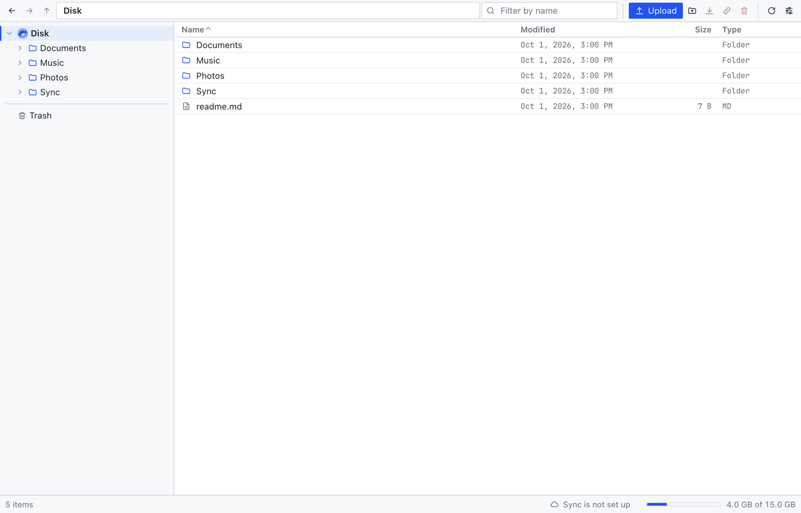
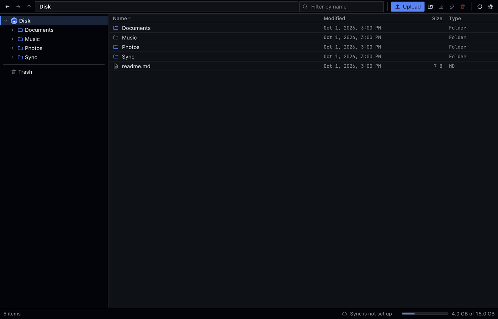
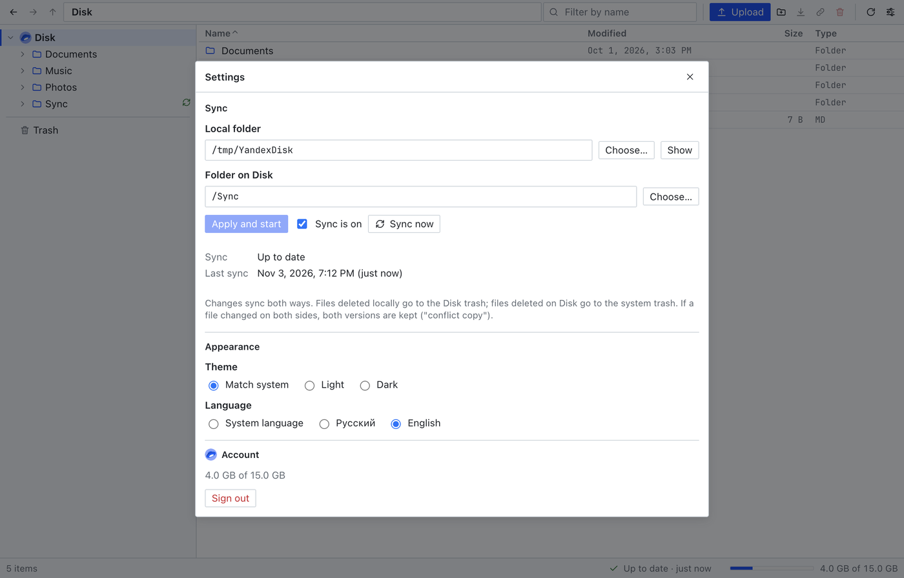
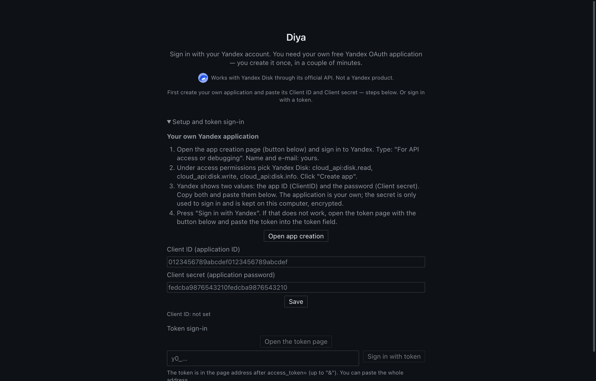
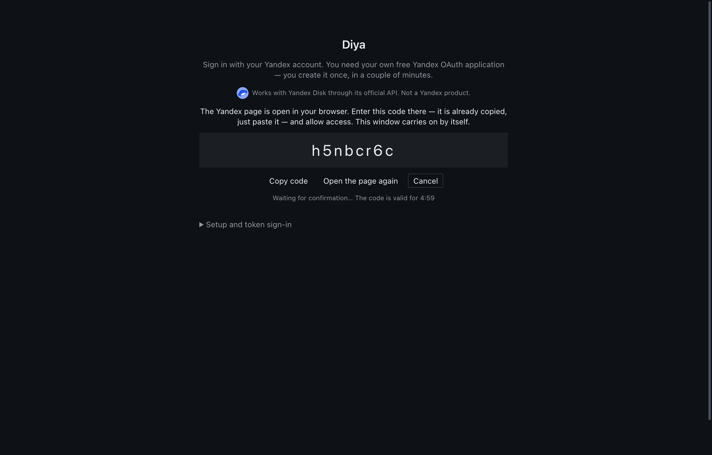
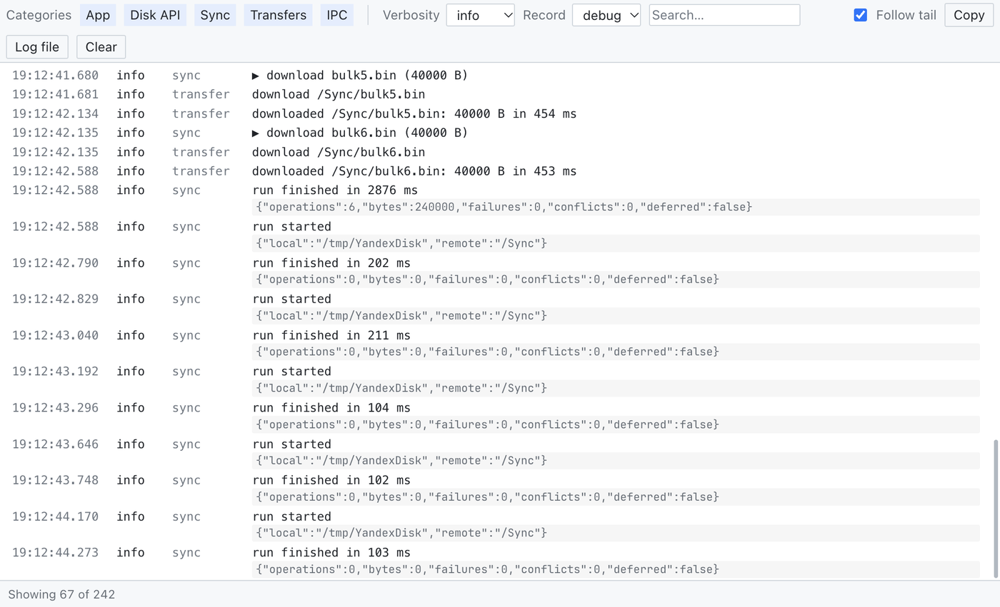

# Diya

[English](README.en.md) · [Русский](README.md)

[](https://github.com/pavel-shvagirev/diya_app/actions/workflows/ci.yml)
[](https://github.com/pavel-shvagirev/diya_app/releases)


Unofficial desktop client for [Yandex Disk](https://disk.yandex.com/): a compact file manager
(folder tree + table), two-way folder sync, trash, and a log window. Windows, macOS and Linux.

> Provided "as is", without warranty ([LICENSE](LICENSE)). Sync moves, overwrites and deletes files
> locally and in the cloud: keep a separate backup of anything you cannot lose.



<details>
<summary>More screenshots</summary>







</details>

## Features

- **File manager:** folder tree, sortable table, breadcrumbs, name filter, drag and drop
  (upload from the OS, move between folders), keyboard control.
- **Operations:** upload and download files and folders, new folder, rename, copy, move,
  delete to the Disk trash, restore (also under a new name; folders in the trash can be opened),
  delete forever, empty trash.
- **Sync:** one pair "local folder ⇄ Disk folder", two-way, every 60 s and on local changes. A file
  changed on both sides keeps both versions (`name (conflict copy YYYY-MM-DD HH-mm).ext`;
  "конфликтная копия" in the Russian interface). Deletions on one side move the file or folder to
  the trash of the other side. A run that would delete a suspicious share of the files is refused.
  Pause/resume from the tray.
- **Log window** (`Ctrl/Cmd+Shift+L`): API calls, transfers and every sync decision with its
  reason; categories, verbosity, search. Tokens and signed links are never written to it; the
  `trace` level also records file names and paths, so do not share a log made at that level.
- **Tray:** closing the window keeps sync running; quit with `Ctrl/Cmd+Q` pressed twice.
- Light/dark theme follows the system. Interface language: English or Russian; it starts with the
  system language and can be fixed in Settings → Language (applies at once, no restart).
- Public links: existing links are shown and can be revoked; creating new ones is disabled.

## Install

Download the file for your system from the
[Releases](https://github.com/pavel-shvagirev/diya_app/releases) page.

| System  | File                                                                 | Notes                                                                                                                                                                               |
| ------- | -------------------------------------------------------------------- | ----------------------------------------------------------------------------------------------------------------------------------------------------------------------------------- |
| macOS   | `.dmg` (Apple Silicon)                                               | Not notarized. First start: System Settings → Privacy & Security → **Open Anyway** (older macOS: right-click → Open), or `xattr -dr com.apple.quarantine "/Applications/Diya.app"`. |
| Windows | `…-win-x64.exe` or `…-win-arm64.exe` (installer), `…-portable.exe`   | Not signed: SmartScreen shows "unknown publisher" (More info → Run anyway).                                                                                                         |
| Linux   | `.AppImage`, `.deb`, `.rpm` (x64 and arm64; built for Ubuntu 26.04+) | AppImage needs `sudo apt install libfuse2t64` on Ubuntu 24.04+: `chmod +x *.AppImage && ./*.AppImage`; `sudo apt install ./*.deb`, `sudo dnf install ./*.rpm`.                      |

### Verify the download

The installers are not code-signed, so check what you downloaded. Each release has `SHA256SUMS.txt`
and a signed build attestation made by the release workflow.

```sh
shasum -a 256 -c SHA256SUMS.txt --ignore-missing   # macOS, Linux (sha256sum -c on Linux)
Get-FileHash .\diya-<version>-win-x64.exe -Algorithm SHA256   # Windows PowerShell: compare by eye
gh attestation verify <file> --repo pavel-shvagirev/diya_app   # GitHub CLI: built by this repository
```

## Sign in

Register your own free application at Yandex once and paste its ID and
secret. Press **Sign in with Yandex**: a code appears in the app window (and is copied); paste it
on the Yandex page that opens and allow access. A token obtained for your application also works.
Step by step: [docs/SIGN_IN.en.md](docs/SIGN_IN.en.md).

The session is stored encrypted with the operating-system keystore (Keychain, DPAPI, or the
libsecret/KWallet keyring on Linux). Without a keystore nothing is saved and sign-in repeats on
each start.

## Using it

- **Sync:** Settings (`Ctrl/Cmd+,`) → choose a local folder and a Disk folder → _Apply and start_.
- **Files:** double-click opens a folder or downloads a file; `F2` rename, `Delete` to trash,
  `Enter` open, `Ctrl/Cmd+A` select all. Right-click for the full menu.
- **About:** menu → About Diya (Help → About on Windows and Linux): version and the repository link.
- **Where data lives:** see [Where the app keeps its data](#where-the-app-keeps-its-data).

## Launch at login

The app has no built-in option; add it to the system's startup list. It starts with its window
open; closing the window keeps sync running from the tray.

- **macOS:** System Settings → General → Login Items & Extensions → **+** under "Open at Login" →
  choose `Diya` in Applications.
- **Windows:** press `Win+R`, run `shell:startup`, and copy the **Diya** shortcut from the Start
  menu (or a shortcut to the portable `.exe`) into the folder that opens.
- **Linux:** put a `.desktop` file into `~/.config/autostart/`.
  - `.deb` / `.rpm`: `cp /usr/share/applications/diya.desktop ~/.config/autostart/`
  - AppImage: create `~/.config/autostart/diya.desktop` containing

    ```ini
    [Desktop Entry]
    Type=Application
    Name=Diya
    Exec=/full/path/to/Diya.AppImage
    ```

To remove: delete the entry (Login Items list, the shortcut, the `.desktop` file).

## Build from source

Node.js 22 or newer.

```sh
npm ci
npm start          # build and run
npm run check      # lint (code, Markdown, YAML) + typecheck + format + tests
npm run e2e        # the real app against an in-memory Disk (needs a display)
npm run dist       # installers for the current OS into release/
```

`YADISK_USER_DATA=<dir>` moves the app data folder (useful for a separate test profile).

Sign-in needs your own application's ID: `YADISK_CLIENT_ID=<id> npm start`, or type it on the
sign-in screen ([docs/SIGN_IN.en.md](docs/SIGN_IN.en.md)). Release process:
[docs/RELEASING.en.md](docs/RELEASING.en.md). Architecture:
[docs/ARCHITECTURE.en.md](docs/ARCHITECTURE.en.md). Contributing:
[CONTRIBUTING.en.md](CONTRIBUTING.en.md) (AI assistants: [AGENTS.md](AGENTS.md)).

## Where the app keeps its data

Everything is in the app data folder; nothing is stored in the registry or elsewhere.

| OS      | Folder                               |
| ------- | ------------------------------------ |
| macOS   | `~/Library/Application Support/diya` |
| Windows | `%APPDATA%\diya`                     |
| Linux   | `~/.config/diya`                     |

| File                | What it is and why it exists                                                                                                                                                                                                                                                                                                                                                                             |
| ------------------- | -------------------------------------------------------------------------------------------------------------------------------------------------------------------------------------------------------------------------------------------------------------------------------------------------------------------------------------------------------------------------------------------------------- |
| `token.bin`         | Your Yandex access and refresh tokens, encrypted with the OS keystore (Keychain, DPAPI, GNOME Keyring/KWallet). If no keystore is available the token is not saved.                                                                                                                                                                                                                                      |
| `client-secret.bin` | The client secret of your Yandex application, encrypted with the OS keystore (not saved at all if there is no keystore). Only sent to Yandex when signing in.                                                                                                                                                                                                                                            |
| `settings.json`     | The OAuth application ID you typed in, if any, the interface language you fixed, and a random device ID that Yandex requires for the sign-in. No passwords, no tokens.                                                                                                                                                                                                                                   |
| `sync.db`           | SQLite database: the sync pair (local folder ⇄ Disk folder) and what each file looked like after the last sync. Without it the next run cannot tell a deletion from a new file, so it is rebuilt cautiously, never by deleting.                                                                                                                                                                          |
| `logs/`             | `diya.log` (over 5 MB it moves to `diya.log.1`, one older copy is kept): API calls, transfers and sync decisions, recorded at `debug` level by default (the level chosen in the log window is not saved between runs). Tokens and signed links are redacted. Recording at `trace` adds full Disk answers with file names and paths: do not pass such a file on. Shown in the log window; safe to delete. |

Theme choice is kept in the app's browser storage inside the same folder. The sync folder you
chose holds your files; the app adds nothing to it except conflict copies.

**Sign out** in Settings deletes `token.bin`. To remove everything, quit the app and delete the
folder. To revoke the app's access on Yandex's side, remove it from the applications with
access to your account in your Yandex ID security settings.

Set `YADISK_USER_DATA` to use another folder (portable use, tests).

## Yandex Disk integration

 Uses the official Yandex Disk REST API and
Yandex OAuth. An independent community project, **not affiliated with Yandex**.

"Yandex", "Yandex Disk" and the Yandex Disk logo are trademarks of Yandex. The logo marks the
integration with the service only (as the [API terms](https://yandex.ru/legal/disk_api/) and the
[brand guidelines](https://360.yandex.ru/brand/) require); it is not this application's logo and
is not covered by the MIT license ([assets/brand/NOTICE.md](assets/brand/NOTICE.md)).

- Sign-in uses standard Yandex OAuth in the system browser; the app never sees the Yandex
  password. Tokens stay on the device and are sent only to Yandex.
- At most 20 requests per second (the API terms allow 40); only your own files, at your request.
- No servers, accounts, analytics or telemetry.
- No Yandex application ID, secret or token ships with the app: each user registers their own
  application at [oauth.yandex.com](https://oauth.yandex.com/) and is its owner under the API
  terms ([docs/SIGN_IN.en.md](docs/SIGN_IN.en.md)). The application secret stays on the computer,
  encrypted.
- The Disk's terms of use apply to the account: <https://yandex.ru/legal/disk_termsofuse/>.

## Limitations

- One sync pair.
- No automatic updates: the app never looks for a new version. Download it from
  [Releases](https://github.com/pavel-shvagirev/diya_app/releases) and install it over the old one
  (settings and sync state are kept).

## License

[MIT](LICENSE). Bundled font: JetBrains Mono (SIL OFL), see [THIRD_PARTY_NOTICES.md](THIRD_PARTY_NOTICES.md).
