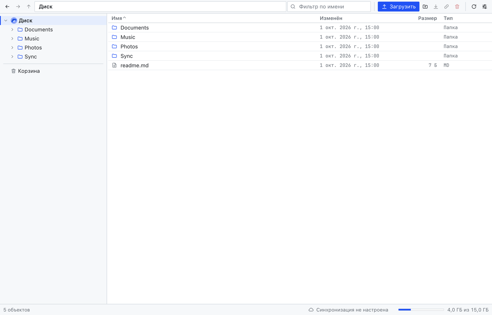
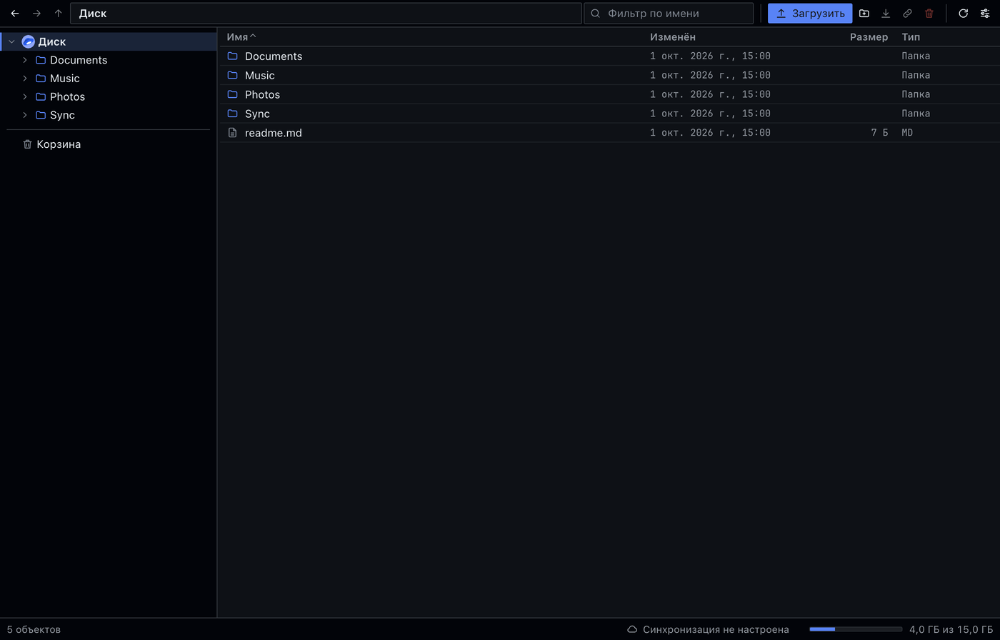
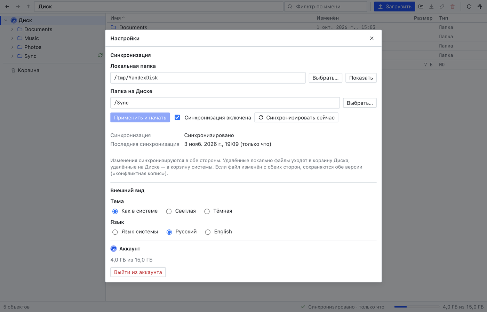
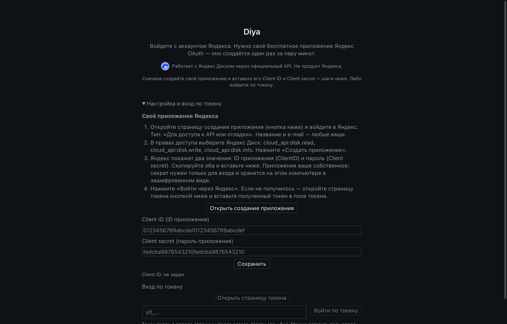
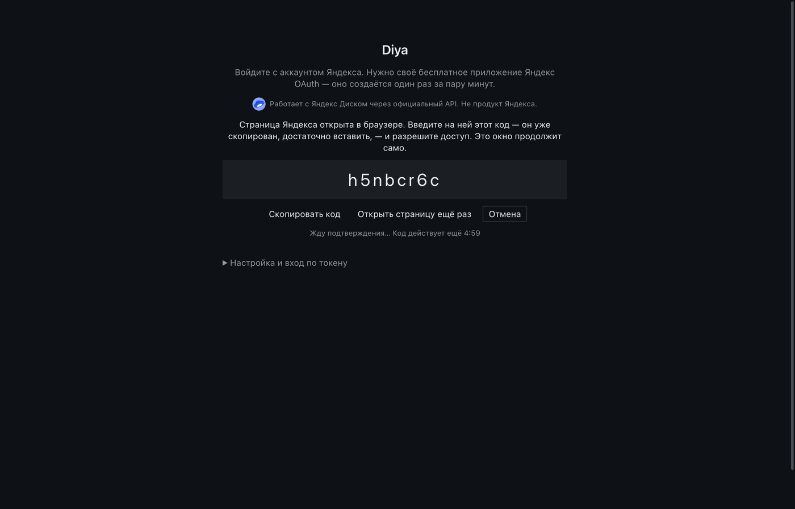
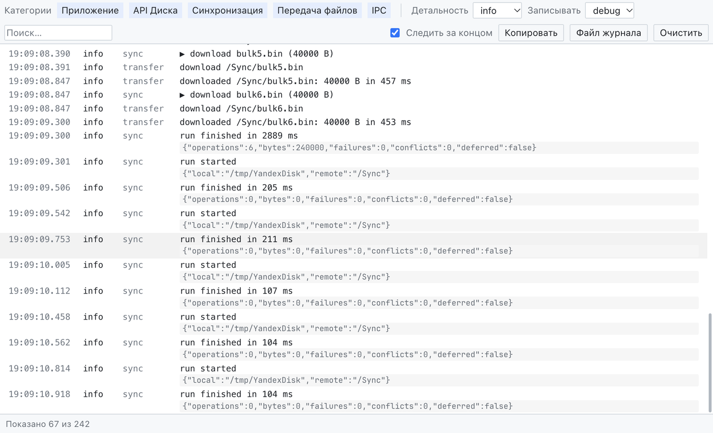

# Diya

[English](README.en.md) · [Русский](README.md)

[](https://github.com/pavel-shvagirev/diya_app/actions/workflows/ci.yml)
[](https://github.com/pavel-shvagirev/diya_app/releases)


Неофициальный десктопный клиент [Яндекс Диска](https://disk.yandex.ru/): компактный файловый
менеджер (дерево папок + таблица), двусторонняя синхронизация папки, корзина и окно журнала.
Windows, macOS и Linux.

> Предоставляется «как есть», без гарантий ([LICENSE](LICENSE)). Синхронизация перемещает,
> перезаписывает и удаляет файлы локально и в облаке - храните отдельную резервную копию
> всего, что нельзя потерять.



<details>
<summary>Ещё скриншоты</summary>







</details>

## Возможности

- **Файловый менеджер:** дерево папок, таблица с сортировкой, «хлебные крошки», фильтр по имени,
  перетаскивание (загрузка из ОС, перенос между папками), управление с клавиатуры.
- **Операции:** загрузка и скачивание файлов и папок, новая папка, переименование,
  копирование, перемещение, удаление в корзину Диска, восстановление (в том числе под новым
  именем; папки в корзине открываются), удаление навсегда, очистка корзины.
- **Синхронизация:** одна пара «локальная папка ⇄ папка на Диске», в обе стороны, раз в 60 с и при
  изменениях на компьютере. Файл, изменённый с обеих сторон, сохраняется в двух версиях
  (`имя (конфликтная копия YYYY-MM-DD HH-mm).ext`; в английском интерфейсе — `conflict copy`).
  Удаление с одной стороны переносит файл или папку в корзину другой. Запуск, который удалил бы
  подозрительно много файлов, отклоняется. Пауза и возобновление из трея.
- **Окно журнала** (`Ctrl/Cmd+Shift+L`): обращения к API, передачи и каждое решение синхронизации
  с причиной; категории, детальность, поиск. Токены и подписанные ссылки в журнал не попадают;
  уровень `trace` записывает ещё имена и пути файлов, поэтому журнал этого уровня не передавайте.
- **Трей:** закрытие окна не останавливает синхронизацию; выход — `Ctrl/Cmd+Q` дважды.
- Светлая и тёмная тема по настройке системы. Язык интерфейса: русский или английский; стартует
  с языка системы, постоянный выбор — Настройки → Язык (применяется сразу, без перезапуска).
- Публичные ссылки: существующие видны и закрываются; создание новых отключено.

## Установка

Скачайте файл для своей системы на странице
[Releases](https://github.com/pavel-shvagirev/diya_app/releases).

| Система | Файл                                                                 | Примечания                                                                                                                                                                                                               |
| ------- | -------------------------------------------------------------------- | ------------------------------------------------------------------------------------------------------------------------------------------------------------------------------------------------------------------------ |
| macOS   | `.dmg` (Apple Silicon)                                               | Без нотаризации. Первый запуск: Системные настройки → Конфиденциальность и безопасность → **Всё равно открыть** (старые macOS: правый клик → «Открыть»), либо `xattr -dr com.apple.quarantine "/Applications/Diya.app"`. |
| Windows | `…-win-x64.exe` или `…-win-arm64.exe` (установщик), `…-portable.exe` | Без подписи: SmartScreen показывает «неизвестный издатель» («Подробнее» → «Выполнить в любом случае»).                                                                                                                   |
| Linux   | `.AppImage`, `.deb`, `.rpm` (x64 и arm64; сборка для Ubuntu 26.04+)  | AppImage на Ubuntu 24.04+ требует `sudo apt install libfuse2t64`: `chmod +x *.AppImage && ./*.AppImage`; `sudo apt install ./*.deb`, `sudo dnf install ./*.rpm`.                                                         |

### Проверка скачанного файла

Установщики не подписаны, поэтому проверяйте скачанное. В каждом релизе есть `SHA256SUMS.txt` и
подписанное подтверждение сборки, которое создаёт workflow релиза.

```sh
shasum -a 256 -c SHA256SUMS.txt --ignore-missing   # macOS, Linux (на Linux также sha256sum -c)
Get-FileHash .\diya-<версия>-win-x64.exe -Algorithm SHA256   # Windows PowerShell: сравните глазами
gh attestation verify <файл> --repo pavel-shvagirev/diya_app   # GitHub CLI: собрано этим репозиторием
```

## Вход

Один раз зарегистрируйте своё бесплатное приложение в Яндексе и вставьте его ID и
секрет. Нажмите **Войти через Яндекс**: код появится в окне программы (и будет скопирован); вставьте
его на открывшейся странице Яндекса и разрешите доступ. Работает и токен, полученный для вашего
приложения. По шагам: [docs/SIGN_IN.md](docs/SIGN_IN.md).

Сессия хранится зашифрованной через хранилище ключей ОС (Keychain, DPAPI, либо libsecret/KWallet в
Linux). Без хранилища ничего не сохраняется, вход повторяется при каждом запуске.

## Как пользоваться

- **Синхронизация:** Настройки (`Ctrl/Cmd+,`) → выберите локальную папку и папку на Диске →
  «Применить и начать».
- **О программе:** меню → «О программе Diya» (на Windows и Linux: «Справка» → «О программе Diya»):
  версия и ссылка на репозиторий.
- **Файлы:** двойной клик открывает папку или скачивает файл; `F2` — переименовать,
  `Delete` — в корзину, `Enter` — открыть, `Ctrl/Cmd+A` — выделить всё. Правый клик — полное меню.
- **Где хранятся данные:** см. [Где программа хранит данные](#где-программа-хранит-данные).

## Автозапуск

Встроенной настройки нет; программа добавляется в список автозапуска системы. Запускается с
открытым окном; закрытие окна оставляет синхронизацию работать из трея.

- **macOS:** Системные настройки → Основные → Объекты входа и расширения → **+** в разделе
  «Открывать при входе» → выберите `Diya` в «Программах».
- **Windows:** `Win+R`, выполнить `shell:startup`, скопировать в открывшуюся папку ярлык **Diya** из
  меню «Пуск» (или ярлык на portable `.exe`).
- **Linux:** положите файл `.desktop` в `~/.config/autostart/`.
  - `.deb` / `.rpm`: `cp /usr/share/applications/diya.desktop ~/.config/autostart/`
  - AppImage: создайте `~/.config/autostart/diya.desktop` со строками

    ```ini
    [Desktop Entry]
    Type=Application
    Name=Diya
    Exec=/полный/путь/к/Diya.AppImage
    ```

Чтобы убрать: удалите запись (список объектов входа, ярлык, файл `.desktop`).

## Сборка из исходников

Node.js 22 или новее.

```sh
npm ci
npm start          # собрать и запустить
npm run check      # линтер (код, Markdown, YAML) + типы + формат + тесты
npm run e2e        # настоящее приложение против Диска в памяти (нужен дисплей)
npm run dist       # установщики для текущей ОС в release/
```

`YADISK_USER_DATA=<папка>` переносит папку данных приложения (удобно для отдельного тестового
профиля).

Для входа нужен ID вашего приложения: `YADISK_CLIENT_ID=<id> npm start` либо ввод на экране входа
([docs/SIGN_IN.md](docs/SIGN_IN.md)). Выпуск релизов: [docs/RELEASING.md](docs/RELEASING.md).
Архитектура: [docs/ARCHITECTURE.md](docs/ARCHITECTURE.md). Участие:
[CONTRIBUTING.md](CONTRIBUTING.md) (ИИ-помощникам: [AGENTS.md](AGENTS.md)).

## Где программа хранит данные

Всё лежит в папке данных программы; в реестре и в других местах ничего не хранится.

| ОС      | Папка                                |
| ------- | ------------------------------------ |
| macOS   | `~/Library/Application Support/diya` |
| Windows | `%APPDATA%\diya`                     |
| Linux   | `~/.config/diya`                     |

| Файл                | Что это и зачем                                                                                                                                                                                                                                                                                                                                                                                                                      |
| ------------------- | ------------------------------------------------------------------------------------------------------------------------------------------------------------------------------------------------------------------------------------------------------------------------------------------------------------------------------------------------------------------------------------------------------------------------------------ |
| `token.bin`         | Ваши токены Яндекса (доступа и обновления), зашифрованные хранилищем ОС (Keychain, DPAPI, GNOME Keyring/KWallet). Если хранилища нет, токен не сохраняется.                                                                                                                                                                                                                                                                          |
| `client-secret.bin` | Секрет (Client secret) вашего приложения Яндекса, зашифрованный хранилищем ОС (без хранилища не сохраняется вовсе). Уходит только Яндексу при входе.                                                                                                                                                                                                                                                                                 |
| `settings.json`     | ID OAuth-приложения, если вы ввели свой, выбранный язык интерфейса и случайный ID устройства, который Яндекс требует при входе. Паролей и токенов тут нет.                                                                                                                                                                                                                                                                           |
| `sync.db`           | База SQLite: пара синхронизации (локальная папка ⇄ папка на Диске) и вид каждого файла после последней синхронизации. Без неё программа не отличит удаление от нового файла, поэтому восстанавливает её осторожно и ничего при этом не удаляет.                                                                                                                                                                                      |
| `logs/`             | `diya.log` (больше 5 МБ переносится в `diya.log.1`, остаётся одна старая копия): вызовы API, передачи и решения синхронизации, по умолчанию с уровнем записи `debug` (выбор уровня в окне журнала между запусками не сохраняется). Токены и подписанные ссылки скрыты. Запись на уровне `trace` добавляет полные ответы Диска с именами и путями файлов: такой файл не передавайте. Показывается в окне журнала; файл можно удалить. |

Выбор темы хранится в браузерном хранилище программы внутри той же папки. Выбранная папка
синхронизации содержит ваши файлы; программа ничего в неё не добавляет, кроме конфликтных копий.

**Выход** в настройках удаляет `token.bin`. Чтобы убрать всё, закройте программу и удалите
папку. Чтобы отозвать доступ на стороне Яндекса, удалите программу из списка приложений с
доступом к аккаунту в настройках безопасности Яндекс ID.

Переменная `YADISK_USER_DATA` задаёт другую папку (переносная версия, тесты).

## Интеграция с Яндекс Диском

 Использует официальный REST API Яндекс Диска и
Яндекс OAuth. Независимый проект сообщества, **не связан с Яндексом**.

«Яндекс», «Яндекс Диск» и логотип Яндекс Диска — товарные знаки Яндекса. Логотип обозначает только
интеграцию с сервисом (как требуют [условия API](https://yandex.ru/legal/disk_api/) и
[брендбук](https://360.yandex.ru/brand/)); это не логотип программы, и лицензия MIT на него не
распространяется ([assets/brand/NOTICE.md](assets/brand/NOTICE.md)).

- Вход идёт по стандартной процедуре Яндекс OAuth в системном браузере; пароль Яндекса программа не
  видит. Токены остаются на устройстве и отправляются только Яндексу.
- Не более 20 запросов в секунду (по условиям API допустимо 40); только ваши файлы и только по
  вашему действию.
- Нет серверов, учётных записей, аналитики и телеметрии.
- В программе нет ни идентификатора, ни секрета, ни токена приложения Яндекса: каждый
  пользователь регистрирует своё приложение на [oauth.yandex.ru](https://oauth.yandex.ru/) и по
  условиям API является его владельцем ([docs/SIGN_IN.md](docs/SIGN_IN.md)). Секрет приложения
  остаётся на компьютере в зашифрованном виде.
- К аккаунту применяются условия самого Диска: <https://yandex.ru/legal/disk_termsofuse/>.

## Ограничения

- Одна пара синхронизации.
- Автообновления нет: программа сама не ищет новую версию. Скачайте её со страницы
  [Releases](https://github.com/pavel-shvagirev/diya_app/releases) и установите поверх старой
  (настройки и состояние синхронизации сохранятся).

## Лицензия

[MIT](LICENSE). Встроенный шрифт: JetBrains Mono (SIL OFL), см. [THIRD_PARTY_NOTICES.md](THIRD_PARTY_NOTICES.md).
